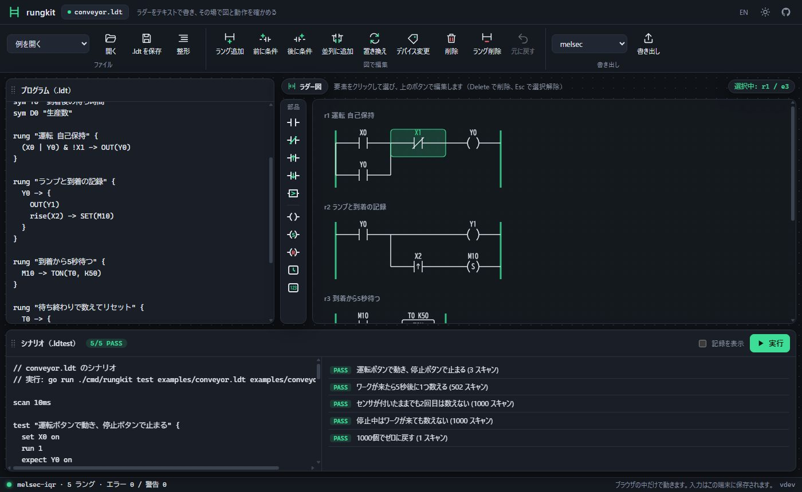

# rungkit

English | [日本語](README.ja.md)

[](https://glama.ai/mcp/servers/Piyoone3939/rungkit)

An AI-native toolkit for PLC ladder programs.
rungkit keeps a ladder diagram as a series-parallel tree, lets an AI agent edit it over MCP, and lets the agent check its own work on a scan simulator. It supports Mitsubishi (MELSEC iQ-R) and IEC 61131-3, and reads and writes ladder text (`.ldt`), JSON, the MELSEC instruction list, Structured Text and PLCopen XML.

> Status: prototype (0.x). Editing commands, simulator, MCP server, PLCopen XML and a browser version are in place.



## Try it in the browser

The browser version runs entirely in the page (Go compiled to WebAssembly): write `.ldt` on the left and see the ladder diagram and diagnostics as you type, click an element to jump to its line or edit it on the diagram (drag contacts, coils, timers and counters from the parts palette onto it, or use the ribbon buttons; Delete and Esc work too), run `.ldtest` scenarios with a trace, and export to every format. Dark and light themes. Nothing is sent anywhere; your input stays in the browser.

Open it at **https://piyoone3939.github.io/rungkit/** (updated with each release by [.github/workflows/pages.yml](.github/workflows/pages.yml)), or build it yourself:

```sh
sh web/build.sh                          # builds web/dist
python -m http.server -d web/dist 8000   # then open http://localhost:8000
```

## Install

```sh
go install github.com/Piyoone3939/rungkit/cmd/rungkit@latest
```

Or download a binary for Windows, macOS or Linux from [GitHub Releases](https://github.com/Piyoone3939/rungkit/releases).

## Use it from an AI (MCP)

```sh
claude mcp add rungkit -- rungkit mcp
```

- Listed in the [official MCP Registry](https://registry.modelcontextprotocol.io/v0.1/servers?search=rungkit) as `io.github.Piyoone3939/rungkit`
- Each release also has MCP Bundles (`rungkit-mcp-<os>-<arch>.mcpb`) that apps supporting MCPB, such as Claude Desktop, install by opening the file
- `rungkit mcp FILE` starts with FILE open
- The MCP server reads and writes only inside the folder it was started in (change with `-root DIR`); standard input (`-`) is refused

Tools:

| Tool | What it does |
|---|---|
| `open_program` / `new_program` / `save_program` | open / start / save (files change only on save) |
| `read_program` | show the program with rung IDs (`// r1`) and element IDs (`X0@e3`) |
| `edit_program` | apply a list of edit commands; all or nothing; one undo step |
| `undo` / `redo` | undo / redo |
| `check_program` | errors and warnings with codes, rung and element IDs |
| `run_scenario` | run scenarios on the simulator (text or a `.ldtest` path; `trace` records every scan) |
| `export_program` | write `melsec` / `gxw3` / `st` / `plcopen` / `json` / `ldt` / `ascii` / `svg` |

Edit commands (`ops` of `edit_program`):

| Command | What it does |
|---|---|
| `add_rung(text, after?, comment?, label?)` | add a rung |
| `replace_rung(rung, text)` / `delete_rung(rung)` / `move_rung(rung, after)` / `set_rung(rung, comment?, label?)` | replace, delete, move or comment a rung |
| `insert_series(target, position, text)` | put conditions before or after an element |
| `insert_parallel(target, to?, text)` | add a branch parallel to an element (or the series range target..to); on an output it adds an output branch |
| `replace_element(target, text)` / `delete_element(target)` / `set_operand(target, operand)` | replace, delete or re-address an element |
| `set_symbol(name, type?, address?, comment?)` / `delete_symbol(name)` | device comments and variable declarations |

Example: add an emergency stop after the stop button

```json
{"ops": [
  {"op": "insert_series", "target": "e3", "position": "after", "text": "!X3"},
  {"op": "set_symbol", "name": "X3", "comment": "emergency stop"}
]}
```

Edits that would make a rung an invalid ladder (a contact right of an output, …) are refused with the reason. Device mistakes (writing an input, …) are not refused but returned as `diagnostics`, so the agent can fix them next.

## Ladder text (.ldt)

```
profile melsec-iqr

sym X0 "start button"
sym X1 "stop button"
sym Y0 "conveyor motor"

rung "run, self-holding" {
  (X0 | Y0) & !X1 -> OUT(Y0)
}

rung "lamp and arrival" {
  Y0 -> {
    OUT(Y1)
    rise(X2) -> SET(M10)
  }
}
```

| Syntax | Meaning |
|---|---|
| `A & B` | series (AND); binds tighter than `\|` |
| `A \| B` | parallel (OR) |
| `!X1` | normally closed contact |
| `rise(X0)` / `fall(X0)` | rising / falling edge |
| `[D0 >= K100]` | comparison (`=` `<>` `<` `<=` `>` `>=`) |
| `condition -> output` | one output at the right end, or a `{ }` block of branches |
| `OUT` `SET` `RST` `PLS` `PLF` | coils |
| `TON(T0, K50)` / `CTU(C0, K10)` | timer / counter |
| `MOV` `ADD` `SUB` `MUL` `DIV` `INC` `DEC` (suffix `P`: once per rising edge) | instructions |
| `// ...` | comment |

Example: [examples/conveyor.ldt](examples/conveyor.ldt)

## Command line

```sh
rungkit check examples/conveyor.ldt          # errors and warnings
rungkit fmt -w examples/conveyor.ldt         # canonical form
rungkit export -to melsec examples/conveyor.ldt
rungkit export -to gxw3 -o conveyor.csv examples/conveyor.ldt   # CSV for GX Works3 (Edit > Import File)
rungkit export -to st examples/conveyor.ldt
rungkit export -to json examples/conveyor.ldt
rungkit export -to ascii examples/conveyor.ldt   # the ladder drawn as text (svg for a picture)
```

`check` gives every problem a code (`E_READ_ONLY`, …) and a line and column, so an agent can fix them one by one.

Messages are available in English and Japanese, chosen by `-lang en|ja`, then `RUNGKIT_LANG`, then the system language.

## PLCopen XML

Reads and writes PLCopen XML (TC6 v2.01) Ladder Diagram, to exchange programs with Beremiz, OpenPLC Editor, CODESYS and others.

```sh
rungkit export -to plcopen -name Conveyor examples/conveyor.ldt > conveyor.xml
rungkit check conveyor.xml          # .xml opens directly (fmt / test / mcp too)
```

- Exports validate against the official schema (tc6_xml_v201.xsd) and build as is in Beremiz ([procedure and results](eval/interop/README.md)); a default 10 ms task is included
- Beremiz runs timer and counter calls after the coils, so a rung reading a timer sees it one scan later than on MELSEC; use the ST export for rung-by-rung semantics
- OpenPLC Editor v4: its importer was read against rungkit's export (not run yet). Rungs, contacts, coils, timers and instructions match its structure; a rung with a comparison should import with OpenPLC's own layout warning ([details](eval/interop/README.md#openplc-editor-v4-source-review--openplc-editor-v4ソースを読んで確認))
- Supported: contacts (NO/NC/rising/falling), coils (set/reset/pulse), TON/TOF/TP/CTU, comparisons (EQ/NE/LT/LE/GT/GE), MOVE/ADD/SUB/MUL/DIV, pulse instructions (through R_TRIG), rung comments
- Import turns the wiring graph back into a series-parallel tree; chained coils and wired ORs work. Circuits that are not series-parallel (bridges) are refused with `E_NON_SERIES_PARALLEL`
- PLCopen is IEC, so melsec programs are written with IEC spellings (`K10` → `10`, `H1F` → `16#1F`, timer `K50` → `T#5000ms`) and the profile is kept in `addData` to restore MELSEC spellings on import
- Changed by a round trip: `INC`/`DEC` become `ADD`/`SUB` (same behavior), `RST` of a word becomes `MOV(K0, …)`, independent circuits in one rung become separate rungs
- Not exportable: `RST` of timers and counters, MELSEC timers with a word device as preset

## Simulator (.ldtest)

Runs the program scan by scan on virtual time and checks it against scenarios.

```
scan 10ms

test "counts a part 5 s after it arrives" {
  set X0 on
  run 1             // one scan
  set X0 off
  set X2 on
  run 4s            // 4 s of virtual time
  expect T0 off
  wait T0 on within 2s
  expect D0 1
}
```

| Command | Meaning |
|---|---|
| `set OP value` | set an input or other device (`on` `off` `123` `K123` `H1F` `5s`) |
| `force OP value` / `unforce OP` | pin a value (program writes are ignored) / release |
| `run N` / `run 5s` | run N scans / a span of time |
| `expect OP value` | check the value now |
| `wait OP value within 6s` | run until the value appears; fail after the time |
| `watch OP...` | record after every scan |
| `// ...` or `# ...` | comment |

`T0.ET` (timer elapsed time) and `C0.CV` (counter value) can be read too. Every test starts from a fresh state.

```sh
rungkit test examples/conveyor.ldt examples/conveyor.ldtest
rungkit test -trace examples/conveyor.ldt examples/conveyor.ldtest   # table of scans where values changed
rungkit test -json examples/conveyor.ldt examples/conveyor.ldtest    # for agents
```

The simulator follows ladder semantics:

- Rungs run top to bottom and every instruction runs every scan (no short-circuit), so edges and timers never miss an input
- Outputs are written immediately; later rungs in the same scan see them
- An output branch uses the power flow from before the branch (like MELSEC MPS)
- MELSEC `T` adds ticks of a free-running 100 ms clock each time it runs, as the CPU does, so it may turn on up to 100 ms before "preset + 1 scan"; counters stop at the set value (a set value of 0 counts as 1); `MUL` writes the high word to D(n+1), `DIV` the remainder to D(n+1), words wrap at 16 bits
- `SM400` (always ON), `SM401` (always OFF), `SM402` (ON for the first scan)
- Division by zero stops with an error naming the scan, rung and element

## Profiles

| Name | |
|---|---|
| `melsec-iqr` | Mitsubishi iQ-R: X/Y/B/W in hexadecimal, `D0.3` bit of word, `K`/`H` constants, timers in 100 ms |
| `melsec-fx5` | Mitsubishi FX5: like `melsec-iqr`, but X/Y in octal (X0-X7, X10, …) |
| `iec` | IEC 61131-3: declare with `sym name : type @ address`, `%IX0.0`, `T#5s` |

## Structure (onion architecture)

Dependencies point inward only; [internal/architecture_test.go](internal/architecture_test.go) enforces it.

| Layer | Package | Role |
|---|---|---|
| Domain | [ladder](internal/domain/ladder/) | rung tree, normalization, shape rules, IDs |
| | [profile](internal/domain/profile/) | vendor devices and instructions |
| | [check](internal/domain/check/) | errors and warnings |
| | [sim](internal/domain/sim/) | scan simulator |
| Application | [editing](internal/application/editing/) | edit commands, undo and redo |
| | [scenario](internal/application/scenario/) | running scenarios |
| | [workspace](internal/application/workspace/) | open, save, check, edit, export, scenarios (what CLI and MCP call); declares the interfaces it needs |
| Infrastructure | [ldt](internal/infrastructure/ldt/) | `.ldt` text |
| | [ldtest](internal/infrastructure/ldtest/) | `.ldtest` scenarios |
| | [jsoncodec](internal/infrastructure/jsoncodec/) | JSON |
| | [export/melsec](internal/infrastructure/export/melsec/) / [export/st](internal/infrastructure/export/st/) | MELSEC list / Structured Text |
| | [plcopen](internal/infrastructure/plcopen/) | PLCopen XML |
| | [filestore](internal/infrastructure/filestore/) | files (outside the working folder refused for MCP) |
| | [locale](internal/infrastructure/locale/) | system language |
| | [render](internal/infrastructure/render/) | ladder drawings as text (`ascii`) and SVG (`svg`) |
| Presentation | [cli](internal/presentation/cli/) / [mcpserver](internal/presentation/mcpserver/) / [web](internal/presentation/web/) | command line / MCP server / browser bindings |
| Shared | [i18n](internal/domain/i18n/) | English and Japanese messages (used by every layer; standard library only) |
| Composition | [cmd/rungkit](cmd/rungkit/) / [cmd/rungkit-web](cmd/rungkit-web/) | wire the adapters and start (CLI and MCP / browser) |

- Design: [docs/design.en.md](docs/design.en.md)
- Decisions (license, distribution, scope): [docs/decisions.en.md](docs/decisions.en.md)
- Checking against Mitsubishi's tools: [docs/verify-melsec.en.md](docs/verify-melsec.en.md)
- How well AI agents use it: [eval/agent](eval/agent/README.md) (Sonnet 5/5, Haiku 5/5 after fixes)

## Safety

- rungkit **does not talk to real PLCs** (no download, monitoring or forcing). Review what it writes and load it with the vendor's tool
- Check ladder written by an AI with `check` and scenarios before use. Build safety functions such as emergency stops in wiring and safety devices, not in software
- The MELSEC instruction sequence follows the standard conversion rules, and the simulator follows Mitsubishi's manuals ([results](docs/verify-melsec.en.md#results-of-c-2026-11-24)). `-to gxw3` writes the CSV GX Works3 imports, following the format in its operating manual, but **importing it into GX Works3 has not been tried yet** ([how to check](docs/verify-melsec.en.md))
- Mitsubishi Electric, MELSEC, GX Works and others are trademarks of their owners. rungkit is not affiliated with them

## Contributing

See [CONTRIBUTING.md](CONTRIBUTING.md). Issues and pull requests are welcome in English or Japanese.

## License

Your choice of [MIT](LICENSE-MIT) or [Apache-2.0](LICENSE-APACHE).
